<div align="center">


<br>

[](https://github.com/Visxoz/YTMusic-Native-IOS/releases/latest)
[](#install)
[](#under-the-hood)
[](#under-the-hood)
[](LICENSE)

<br>

<a href="https://github.com/Visxoz/YTMusic-Native-IOS/releases/latest"></a>

<br>

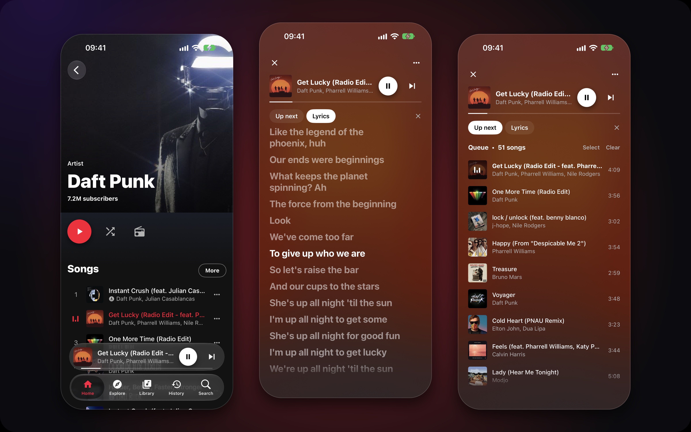

<sub>Artist pages with their banner · lyrics that follow the song, in its artwork's colours · a queue you drag into order</sub>

</div>

<br>

<table>
<tr>
<td width="33%" valign="top">

### Sounds better
256 kbps Opus with Premium, gapless playback, a 6-second crossfade, volume levelling and a six-band equaliser.

</td>
<td width="33%" valign="top">

### Truly native
Swift and SwiftUI from top to bottom, on Apple's own audio engine. No web views, no wrappers, nothing but the app.

</td>
<td width="33%" valign="top">

### Looks the part
Dark, light or pure black, in seven accents, or one that follows the song's artwork. Pages are tinted to match, and Now Playing takes on the artwork's colours.

</td>
</tr>
<tr>
<td width="33%" valign="top">

### Plays like YouTube Music
Radio, autoplay, Smart Shuffle, repeat, history and search with recent searches. Speed dial on Home, and artist pages with the whole discography. Songs, albums and playlists download to play offline.

</td>
<td width="33%" valign="top">

### Lyrics and queue
Swipe up from the artwork for synced lyrics you can tap to jump to, and a queue you drag into order, edit several songs at a time, and save as a playlist.

</td>
<td width="33%" valign="top">

### At home on iPhone
The lock screen, Control Center, the volume buttons and your AirPods, Last.fm, and a Liquid Glass tab bar and icon. Reopens on the song you left, at the second you left it.

</td>
</tr>
</table>

## Make it yours

<table>
<tr>
<td width="25%">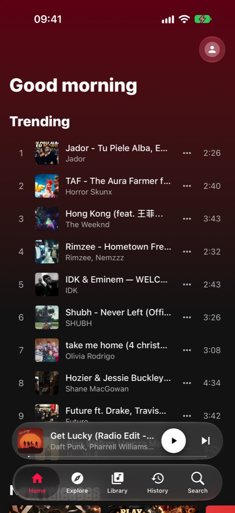</td>
<td width="25%">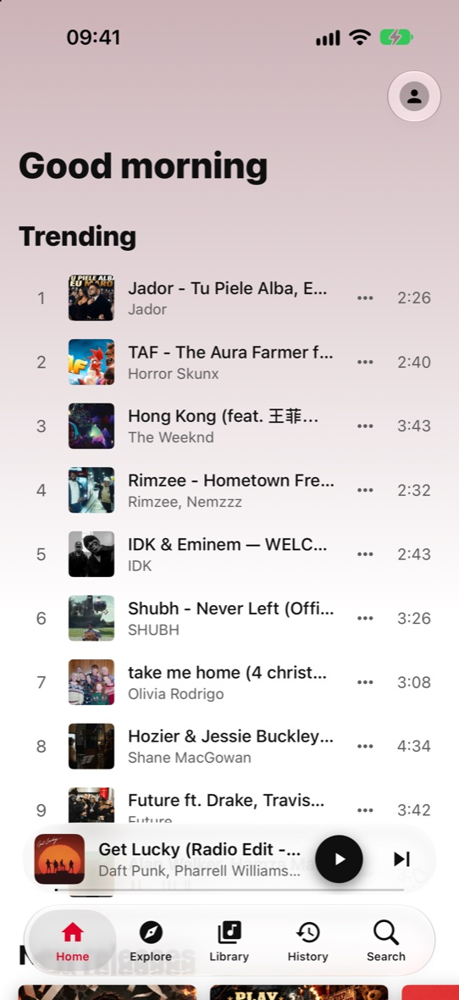</td>
<td width="25%">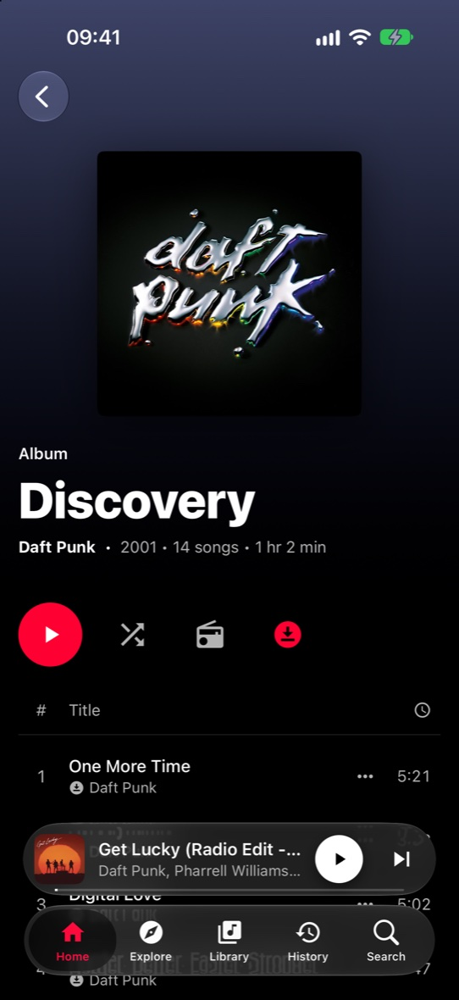</td>
<td width="25%">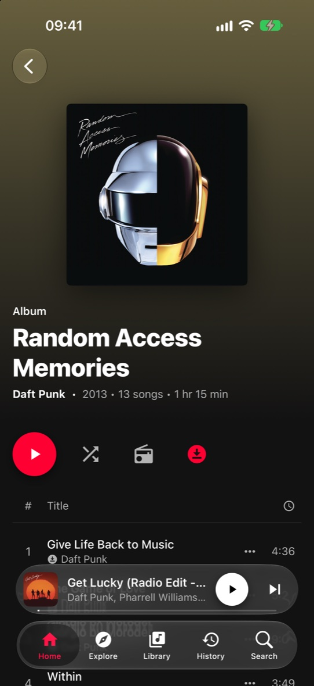</td>
</tr>
<tr>
<td align="center"><b>Dark</b> · Home, tinted with your accent</td>
<td align="center"><b>Light</b> · for daytime</td>
<td align="center"><b>Black</b> · for OLED screens</td>
<td align="center"><b>Albums</b> · tinted from the cover</td>
</tr>
<tr>
<td width="25%">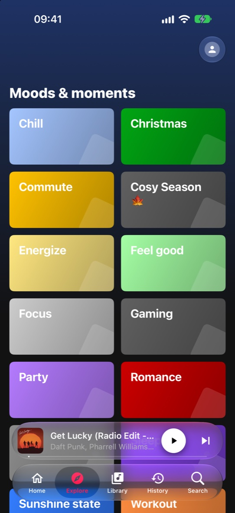</td>
<td width="25%">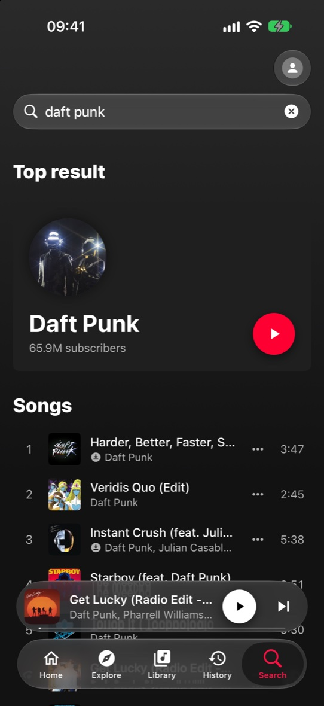</td>
<td width="25%">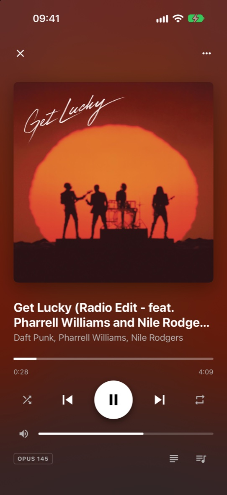</td>
<td width="25%">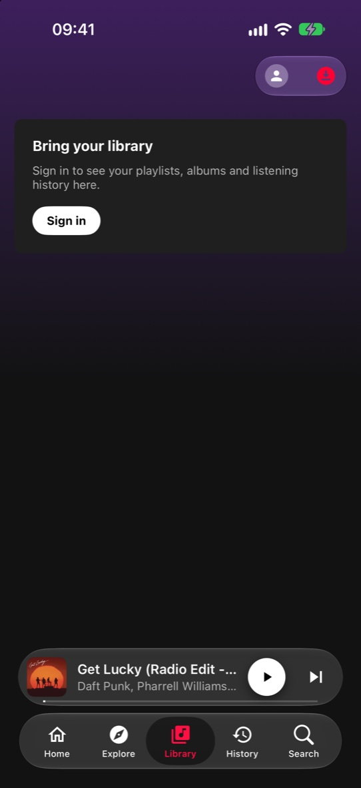</td>
</tr>
<tr>
<td align="center"><b>Explore</b> · moods, moments and more</td>
<td align="center"><b>Search</b> · with a top result</td>
<td align="center"><b>Now Playing</b> · in the artwork's colours</td>
<td align="center"><b>Library</b> · yours when signed in, with downloads</td>
</tr>
</table>

Pick a theme and an accent colour in **Settings ▸ Appearance**: Red, Orange, Green, Teal, Blue, Purple, Pink, or **From the artwork**.

## Sounds as good as YouTube gets

<table>
<tr>
<td width="62%">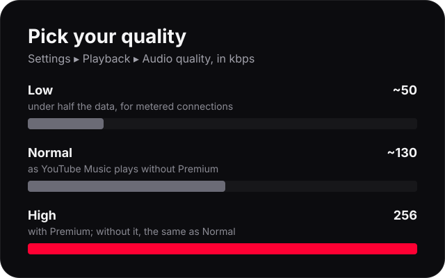</td>
<td width="38%">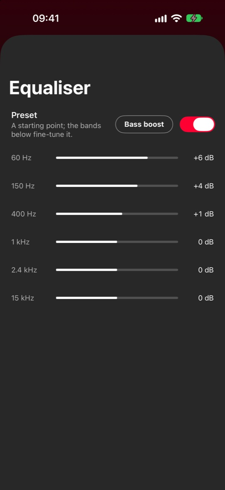</td>
</tr>
</table>

| Feature | What it does |
| --- | --- |
| **Premium streams** | Signed in with Premium on High, songs play in YouTube's 256 kbps formats, and Now Playing says so. Music videos swap to their song versions to get them. |
| **Gapless** | The next song is lined up 15 seconds early and follows without a gap, and the screen changes the moment the sound does. |
| **Crossfade** | Fades each song into the next over 6 seconds, cutting the silence at the joins. An album played in order still runs straight on, and skipping never fades. |
| **Equaliser** | Six bands from 60 Hz to 15 kHz, ±12 dB each, with presets: Flat, Bass boost, Treble boost, Vocal, Rock, Electronic and Acoustic. Boosting turns the rest down to leave headroom. |
| **Normalise volume** | Plays every track at a similar loudness, from YouTube's own measurement, as YouTube Music does. |
| **No clicks, no drop-outs** | Pausing ramps the sound down, and seeks and skips fade in. Unplug your headphones and the music carries on through the speaker. |

## Take it offline

<table>
<tr>
<td width="62%" valign="top">

Tap the download button on an album or playlist, or **Download** in any song's menu, and it plays from the phone after that, online or not. Offline, the queue skips what isn't downloaded, and downloaded albums and playlists still open.

| Feature | What it does |
| --- | --- |
| **Smart downloads** | Keeps 25 to 200 songs downloaded, from what you play and more like it, picked afresh each day. |
| **Stays current** | Downloaded albums and playlists pick up YouTube's changes once a day. |
| **Wi-Fi only** | Downloads wait for Wi-Fi rather than use mobile data or a hotspot, unless you say otherwise. |
| **Download quality** | Set apart from streaming: Low, Normal or High, which is 256 kbps Opus with Premium. |

Find them behind the download button at the top of Library, and the settings in **Settings ▸ Downloads**.

</td>
<td width="38%">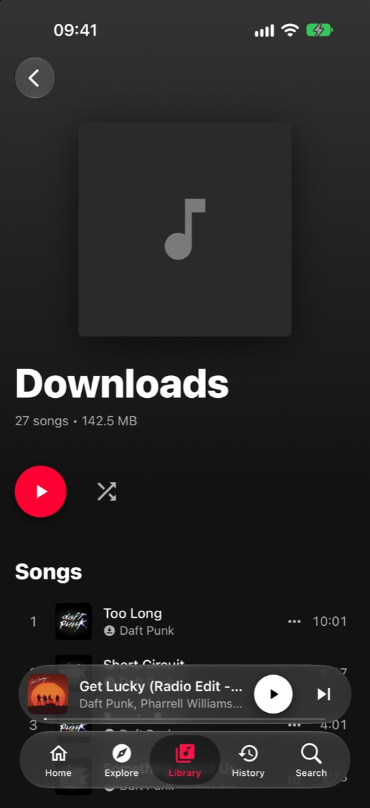</td>
</tr>
</table>

## Install

Grab `YTMusic.ipa` from the [latest release](https://github.com/Visxoz/YTMusic-Native-IOS/releases/latest), then:

1. Open it with **SideStore** (or share it to SideStore), or tap **+** in SideStore's My Apps and pick the file.
2. SideStore signs it with your own Apple ID and installs it.
3. Open **YT Music**. It works signed out straight away.

> [!NOTE]
> Apps signed with a free Apple ID last seven days. SideStore refreshes them in the background; if it hasn't, open SideStore and tap **Refresh All**.

## Getting around

| Do | To |
| --- | --- |
| Tap the mini player | Open Now Playing |
| Swipe up on Now Playing, or tap **Up next** or **Lyrics** | Show the queue or the lyrics under the player |
| Swipe down | Go back to the artwork, then close Now Playing |
| Tap the song or artist in Now Playing | Go to its album or artist |
| Tap a lyric line | Jump to it |
| Drag a song in the queue | Move it |
| Swipe a song in the queue | Remove it |
| **Select** in the queue | Pick several songs, then play them next or remove them |
| Press and hold a song | Play it next, add it to the queue, start a radio, download it, like it, save it to a playlist, or go to its artist or album |
| Press and hold a card | Play it, start a radio, or download an album or playlist |
| Tap the shuffle button | Cycle Off, Shuffle and **Smart Shuffle**, which mixes in recommendations |

## Your account

Tap the account button, then **Settings ▸ Account ▸ Sign in**, and sign in on Google's own page. The page closes by itself once you're in. Your playlists, albums and artists appear in Library, Home becomes your own feed, and what you play here counts towards your YouTube Music history and recommendations, unless you turn off **YouTube history** in **Settings ▸ Account**.

The sign-in is kept in the iPhone's Keychain, for this device only. Google's page is shown in a private web view that's thrown away as soon as you're signed in.

<details>
<summary><b>Connecting Last.fm</b></summary>
<br>

Tap **Settings ▸ Account ▸ Last.fm ▸ Connect**, then allow access on Last.fm's page. Plays scrobble from then on, including ones made while you were offline.

Building it yourself? Last.fm needs an [API account](https://www.last.fm/api/account/create). Put its key and secret in `Config/Secrets.xcconfig` as `LASTFM_API_KEY = …` and `LASTFM_API_SECRET = …`; without them, Settings says Last.fm is unavailable.

</details>

> [!WARNING]
> YT Music for iOS is an unofficial client. It uses YouTube's undocumented API, which is against YouTube's terms of service. Google could ask you to confirm you're not a bot or sign the session out, and could in principle restrict the account. A separate account is the safest choice.

## Under the hood

Everything you see and hear is native code, written in Swift. A web view only appears while you sign in, to show Google's page.

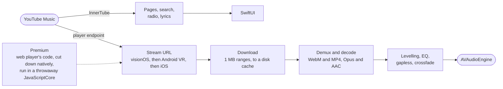

<details>
<summary><b>What it's built with</b></summary>
<br>

| Part | Built with |
| --- | --- |
| YouTube Music data | YouTube's InnerTube API, called directly (`YTMCore`) |
| Stream URLs | YouTube's player endpoint, called directly (`YTMCore/Streams`) |
| Premium URLs | A Swift tokenizer that cuts the player down, and JavaScriptCore |
| Demuxing | Its own WebM and MP4 readers (`YTMAudio`) |
| Opus and AAC | AudioToolbox |
| Audio output | AVAudioEngine, with AVAudioUnitEQ |
| Interface | SwiftUI, with ytm-native's own icons drawn as shapes, and Now Playing's mesh gradient taken from the artwork |
| Networking | URLSession over HTTP/2 |
| Artwork | ImageIO, decoded at the size it's shown |
| Lock screen, AirPods and volume | MediaPlayer |
| Offline and Wi-Fi only | The Network framework |
| Google sign-in | WebKit, only while signing in |

Most YouTube clients get stream URLs that YouTube's player JavaScript has to unscramble. The visionOS client gets plain ones, so the app asks as that client and needs no JavaScript engine, falling back to Android VR and iOS if YouTube changes it. With Premium, the app unscrambles the web player's URLs itself, in a short-lived JavaScriptCore context with a cut-down copy of the player.

Apple's AudioToolbox decodes Opus, but can't read the WebM files YouTube keeps it in, so the app reads them itself and hands AudioToolbox the packets as they download.

The app talks only to YouTube's hosts, plus Last.fm if you connect it, each checked against an allowlist.

</details>

<details>
<summary><b>Building from source</b></summary>
<br>

You need Xcode 27.2. There are no dependencies to fetch.

```sh
cd Packages/YTMKit
swift test               # the unit tests
swift run ytmcheck all   # checks every page, stream and decode path against live YouTube
cd ../..
scripts/build-ipa.sh     # build/YTMusic.ipa, unsigned, for SideStore
```

Or open `YTMusic.xcodeproj` and run it on the iPhone simulator.

| Path | What it holds |
| --- | --- |
| `App/` | The SwiftUI app |
| `Packages/YTMKit/Sources/YTMCore` | Models, the InnerTube API, page parsing, streams and Premium, persistence, Last.fm, artwork |
| `Packages/YTMKit/Sources/YTMAudio` | Streaming download, saving downloads, the WebM and MP4 readers, decoding and the audio engine |
| `Packages/YTMKit/Sources/YTMPlayback` | The queue, the player, Now Playing, Smart Shuffle, downloads, scrobbling |
| `Packages/YTMKit/Sources/ytmcheck` | A macOS tool that checks the app's YouTube paths are still working |

</details>

## Licence

YT Music for iOS is a port of [ytm-native](https://github.com/Visxoz/ytm-native) and, like it, free software under the [GNU General Public License, version 3](LICENSE).

<br>

<div align="center">
<sub>Not affiliated with, endorsed by or connected to YouTube or Google. YouTube Music is a trademark of Google LLC.</sub>
</div>
