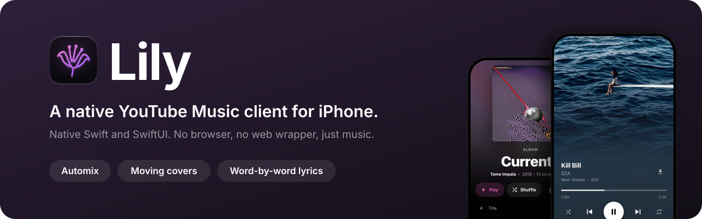
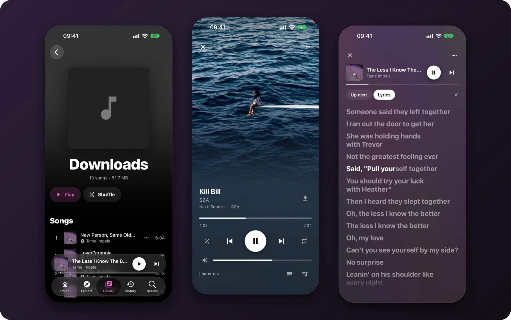
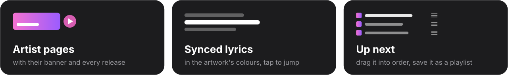
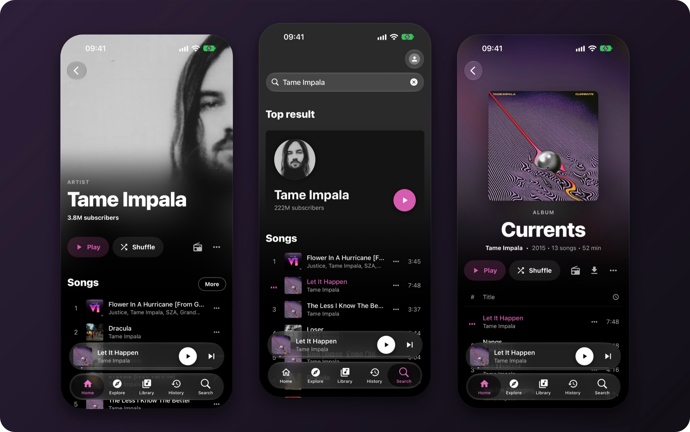
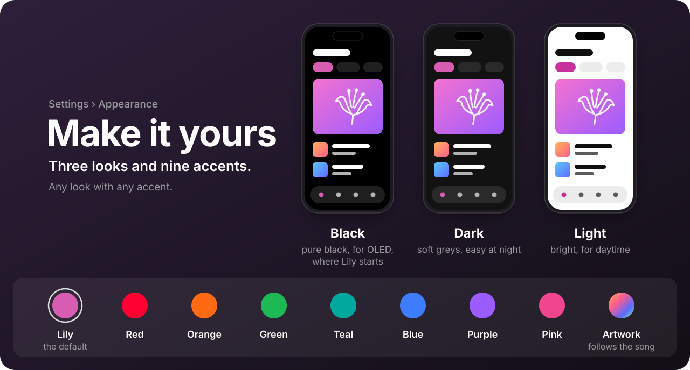
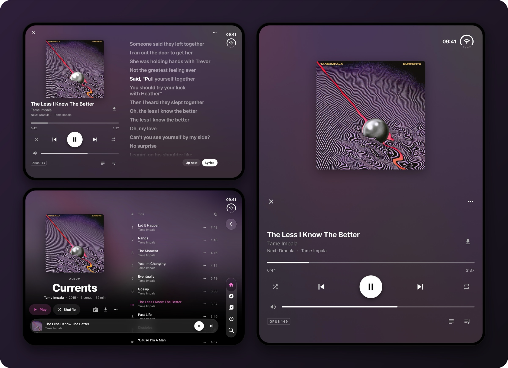
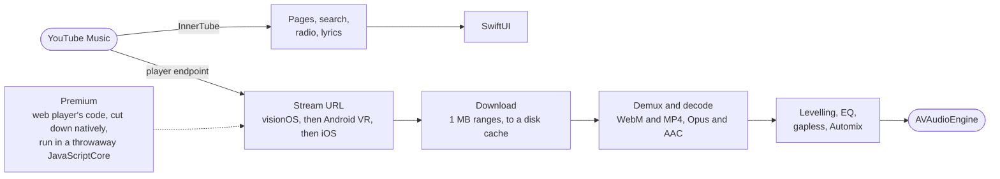

<div align="center">



<br>

[](https://github.com/Visxoz/Lily-ios/releases/latest)
[](https://github.com/Visxoz/Lily-ios/releases)
[](#install)
[](LICENSE)

<br>

<a href="https://intradeus.github.io/http-protocol-redirector?r=altstore://source?url=https://github.com/Visxoz/Lily-ios/releases/latest/download/source.json"></a>&nbsp;&nbsp;<a href="https://intradeus.github.io/http-protocol-redirector?r=sidestore://source?url=https://github.com/Visxoz/Lily-ios/releases/latest/download/source.json"></a>
<br>
<a href="https://intradeus.github.io/http-protocol-redirector?r=feather://source/https://github.com/Visxoz/Lily-ios/releases/latest/download/source.json"></a>&nbsp;&nbsp;<a href="https://github.com/Visxoz/Lily-ios/releases/latest"></a>

<br>





<br>

**[Why Lily](#why-lily)** · **[Looks](#make-it-yours)** · **[iPhone Duo](#made-for-iphone-duo)** · **[Install](#install)** · **[Your account](#your-account)** · **[Under the hood](#under-the-hood)**

</div>

## Why Lily

<table>
<tr>
<td width="33%" valign="top">

### Moving covers
Where an album has a moving cover, Now Playing plays it full screen as in Apple Music, and so does the lock screen. Sign in to Spotify in **Settings ▸ Appearance** and songs show their Canvas.

</td>
<td width="33%" valign="top">

### Lyrics, word by word
Tap the lyrics button in Now Playing for lyrics that light up word by word as they're sung. Tap a line to jump to it.

</td>
<td width="33%" valign="top">

### Automix
Blends each song into the next like a DJ, over a fade-out or a quiet intro, on the bar or the beat, nudging the tempo to meet when it's close. It trades the bass, sweeps or echoes out, and uses the timed lyrics to keep two singers from overlapping. Turn it on in **Settings ▸ Playback**; otherwise songs follow on gaplessly.

</td>
</tr>
<tr>
<td width="33%" valign="top">

### Sound
256 kbps Opus with Premium, volume levelling, a ten-band equaliser and wide stereo, on Apple's own audio engine.

</td>
<td width="33%" valign="top">

### Takes it offline
Download songs, albums and playlists to play anywhere. Smart downloads, in **Settings ▸ Downloads**, keeps the songs you play and more like them on the phone, picked afresh each day.

</td>
<td width="33%" valign="top">

### Native
Swift and SwiftUI from top to bottom, with no web wrapper. It reopens on the song you left, at the second you left it.

</td>
</tr>
</table>



## Make it yours



## Made for iPhone Duo



Open it up and every screen is laid out again for its two halves: the player beside its lyrics or queue, and albums beside their tracks. Stand it half open and the artwork faces you, with the controls on the flat half. The open layouts need iOS 27.1 or later.

## Install

1. On your iPhone, tap **Add to AltStore**, **Add to SideStore** or **Add to Feather** at the top of this page.
2. Your store opens and adds Lily's source. Install Lily from it.
3. That's it: Lily works signed out straight away, and new versions show up in your store as updates.

If a button does nothing, add the source by hand: copy this link, and paste it in your store's **Sources** tab.

```
https://github.com/Visxoz/Lily-ios/releases/latest/download/source.json
```

Or grab `Lily.ipa` from the [latest release](https://github.com/Visxoz/Lily-ios/releases/latest) and open it with any of them.

> [!NOTE]
> Apps signed with a free Apple ID last seven days. AltStore and SideStore refresh them in the background; if they haven't, open the store and tap **Refresh All**.

> [!WARNING]
> Lily is an unofficial client. It uses YouTube's undocumented API, which is against YouTube's terms of service. Google could ask you to confirm you're not a bot or sign the session out, and could in principle restrict the account. A separate account is the safest choice.

## Your account

Tap the account button, then **Settings ▸ Account ▸ Sign in**, and sign in on Google's own page. Home, Library and history become yours, and you can save albums and playlists, subscribe to artists, and edit your own playlists. What you play counts towards your YouTube history unless you turn off **YouTube history** in **Settings ▸ Account**. The sign-in is kept in the iPhone's Keychain, for this device only.

To scrobble, tap **Settings ▸ Account ▸ Last.fm ▸ Connect**, or paste your ListenBrainz user token under **ListenBrainz**.

## Under the hood

Everything you see and hear is native code, written in Swift. A web view appears only to show Google's or Spotify's sign-in page, and, out of sight, for the lyrics hub's Cloudflare check.

<details>
<summary><b>How it works</b></summary>
<br>



Most YouTube clients get stream URLs that YouTube's player JavaScript has to unscramble. The visionOS client gets plain ones, so the app asks as that client and needs no JavaScript engine, falling back to Android VR and iOS if YouTube changes it. With Premium, the app unscrambles the web player's URLs itself, in a short-lived JavaScriptCore context with a cut-down copy of the player.

Apple's AudioToolbox decodes Opus, but can't read the WebM files YouTube keeps it in, so the app reads them itself and hands AudioToolbox the packets as they download.

The app talks only to YouTube's hosts, plus Apple Music's and Spotify's for moving covers, Better Lyrics' hub, lrc.red, LRCLIB and KuGou (Tencent Music, in China) for lyrics (sent a song's title, artist and length while lyrics are open, and the hub its video ID too; KuGou only when the others have no word timing), and Last.fm and ListenBrainz if you connect them, each checked against an allowlist.

The hub wants a pass from Cloudflare's check, which the app runs about once a day in a hidden web view. It follows the proxy set in iOS, or an HTTP or SOCKS5 proxy of your own entered in **Settings ▸ Account ▸ Proxy**, used from Lily's next start.

</details>

<details>
<summary><b>Building from source</b></summary>
<br>

You need Xcode 27.2. There are no dependencies to fetch.

```sh
cd Packages/YTMKit
swift test               # the unit tests
swift run ytmcheck all   # checks every page, stream and decode path against live YouTube
cd ../..
scripts/build-ipa.sh     # build/Lily.ipa, unsigned
scripts/lint.sh          # the lint CI runs
```

Or open `Lily.xcodeproj` and run it on the iPhone simulator. Last.fm needs an [API account](https://www.last.fm/api/account/create): put its key and secret in `Config/Secrets.xcconfig` as `LASTFM_API_KEY = …` and `LASTFM_API_SECRET = …`.

Every release is built by [GitHub Actions](.github/workflows/release.yml) from main, never on anyone's computer. To check a download came from there, run `gh attestation verify Lily.ipa --repo Visxoz/Lily-ios --signer-workflow Visxoz/Lily-ios/.github/workflows/release.yml`.

</details>

## Licence

Lily for iPhone is a port of [Lily for Windows](https://github.com/Visxoz/lily) and, like it, free software under the [GNU General Public License, version 3](LICENSE).

Lyrics come partly from [Better Lyrics](https://github.com/better-lyrics/better-lyrics)' lyrics hub. Thanks to Better Lyrics for it.

<br>

<div align="center">
<sub>Not affiliated with, endorsed by or connected to YouTube or Google. YouTube Music is a trademark of Google LLC.</sub>
</div>
